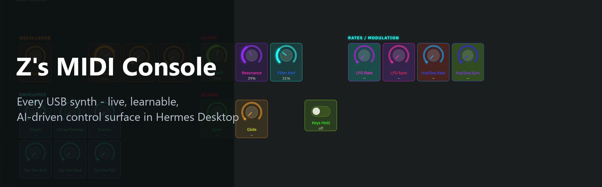
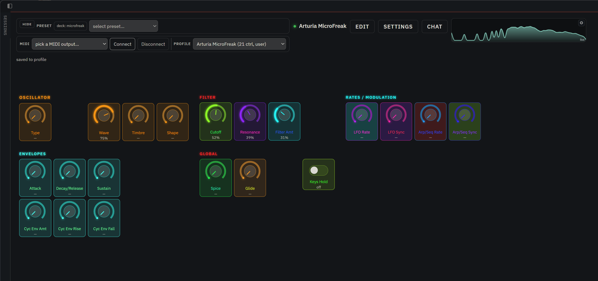
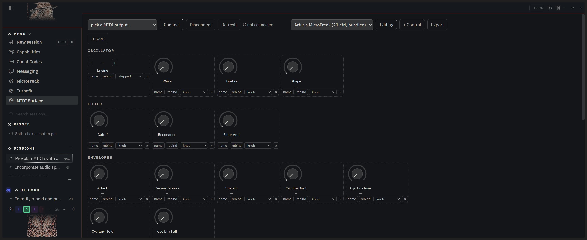
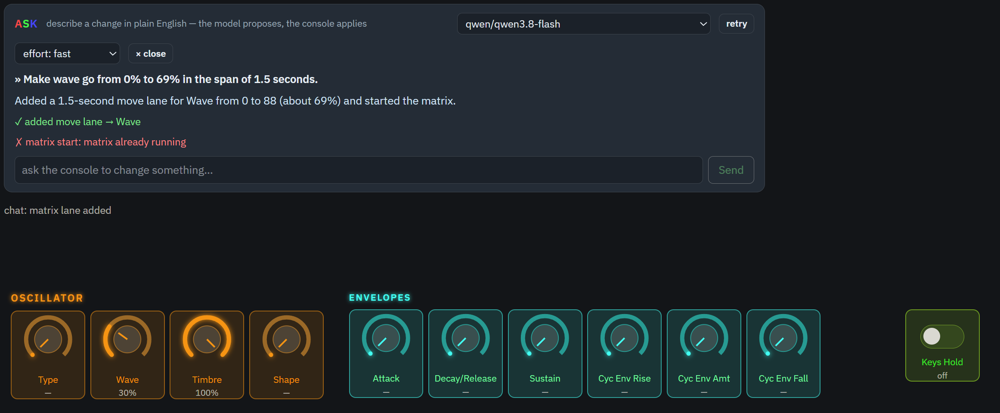
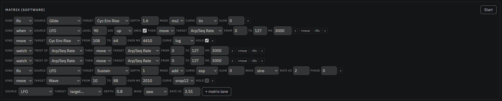
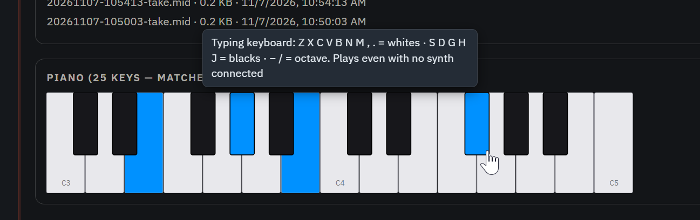
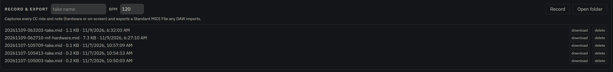

# Z's MIDI Console



**Turn any USB MIDI synth into a live, editable, AI-driven control surface inside [Hermes Agent](https://hermes-agent.nousresearch.com) — then play it, paint it, modulate it, record it, and drive it from chat.**

Plug a synth in, pick its port, connect: every knob, slider and toggle appears on screen and *tracks the hardware in real time* — twist a physical knob, the on-screen knob follows; drag the on-screen one, the hardware moves. No drivers, no middleware, no virtual cables, zero Python dependencies.

| The live surface (bundled MicroFreak profile) | Layout editing (rename, rebind, widget type, delete) |
|---|---|
|  |  |

| Plain-English AI edits (the chat box) | Software modulation matrix |
|---|---|
|  |  |

| On-screen piano | Record & export .mid |
|---|---|
|  |  |

## What you can actually do with it

- **Run your whole rack from one screen.** Bind several synths to distinct MIDI ports and render them side by side as one deck — each surface live from its own bus. A control surface for hardware that never had one.
- **Sound-design in plain English.** The CHAT box takes "ramp wave 0→100% over 5 seconds", "make the filter knob gentle purple", "once timbre passes 70%, swing resonance back and forth", "save this as a new preset called Freakytime". The model only *proposes* — every op passes a strict whitelist and lands through the normal undo-able edit path, so an AI can't wreck your synth.
- **Perform without touching the synth.** The software modulation matrix runs LFOs, one-shot ramps, level-triggers and knob-twist-triggers against any control. Start it, and every target's value is captured; Stop restores every value exactly. Panic-safe by construction.
- **Capture a take, get a real .mid.** Hit Record, ride knobs or play notes (hardware or on-screen), stop — out comes a Standard MIDI File any DAW imports. Your hardware jam, as MIDI data.
- **Give the agent hands.** Seven agent tools (`midi_devices`, `midi_status`, `midi_send`, `midi_control`, `midi_profile`, `midi_matrix`, `midi_recorder`): Hermes itself can connect, play, tweak, run the matrix and export takes from any chat.
- **Demo instantly with no hardware at all.** The on-screen piano is sized to the synth's real key range and plays over MIDI — type Z X C V B N M without a synth connected.

## Features

- **Live surface** — knobs, sliders, toggles, momentaries that mirror hardware moves in real time and drive the hardware back when you drag them. Measured labels turn a slider into honest detents — no invented steps.
- **Deck: several synths on one screen** — bind presets to distinct MIDI ports and render them side by side, each surface live from its own bus; pick a saved layout ("select preset") or add a device without leaving the page.
- **MIDI-learn** — twist a knob on the synth and the surface offers to bind it to a control; ignore the noise CCs once and manage them later (SETTINGS → ignored inputs). No config files needed.
- **Layout editor** — real 2D grids for controls AND categories: drag knobs between categories, drag whole category lanes across rows/slots, occupant push-out, drop previews exactly the size of what you move, corner-resize the wide boxes. Undo/redo across every mutation; SAVE EDIT / DISCARD.
- **Color engine** — hue wheel or exact hex per part (category label, box, knob ring, name, card background); FL-mixer-grade strong rendering. Plus a rainbow-ifier that paints a whole category as one band of the spectrum.
- **Spectrum analyzers** — up to 4 draggable analyzer boxes, each listening to a chosen source (one device, all MIDI traffic incl. physical knob-twists, desktop audio, microphone, or everything) with 12+ canvas styles; resize by pulling the corner.
- **On-screen piano** — sized to the synth's real key range (MicroFreak ships its 25-key declaration; the Push profile declares its 64-pad note grid); lights with live notes; click to play, or type — Z X C V B N M + S D G H J, − / = shift octave.
- **Device profiles** — JSON documents (bundled + user tiers) describing controls, CC bindings, layout and aliases. Refuse-closed validation, atomic saves, import/export, rename/copy/delete. Bundled Arturia MicroFreak, Cloudburst and Ableton Push (full 84-CC surface map, community-hardware-verified) profiles ship as flagships.
- **Software modulation matrix** — four lane kinds, one small vocabulary: **lfo** (sine/tri/saw/shuffle-random S&H, own rate + phase per lane), **move** (one-shot envelope: ramp a CC from a to b over N seconds), **when** (fire when a source crosses a level) and **watch** (fire the moment a knob is twisted) — triggers run ramps or named-range oscillations (center/amp).
- **Wire remap** — any control can declare `invert` or an output sub-range (`out_min/out_max`) for backwards or bipolar parameters; the surface keeps speaking one friendly 0–127 domain and only the wire gets remapped.
- **Record & export** — hit Record, ride the knobs / play notes (hardware or on-screen), stop, and get a Standard MIDI File any DAW imports.
- **Ask (chat box)** — a CHAT button beside SETTINGS talks to whichever model lane you pick: the picker mirrors Hermes' own model selector, so local lanes (LM Studio / Ollama / gateway) AND cloud providers or subscriptions you have configured appear — individual to your install. The guard is "nothing crosses the open internet unencrypted": https anywhere, plain http only on loopback/LAN/Tailscale. Your preset summary travels with the ask — that is how the model knows your controls.
- **Agent tools** — the seven tools listed above; every REST route the pane uses mirrors one of them.

## Zero setup

Windows already owns every class-compliant USB MIDI device — the plugin talks to the same system MIDI stack (winmm via ctypes, zero Python dependencies, no compiled wheels, no admin). Plug the synth in, pick its port, connect. The pane remembers the port and auto-connects next time; a bundled profile whose match rule fits the device activates itself.

Control works with anything that receives MIDI CC; live mirroring and MIDI-learn work with anything that sends CC back (most synths do).

## Install

Requires Hermes Agent >= 0.23 on Windows.

```bash
hermes plugins install zorroukk/z-midi-console
hermes plugins enable z-midi-console
```

Restart Hermes (or let the plugin host pick it up), then open the **MIDI Console** tab in Hermes Desktop. The agent side registers the seven tools immediately — you can drive a synth from chat.

## Try it in two minutes

1. Plug in any class-compliant USB MIDI synth. In the pane pick its IN/OUT pair and hit **Connect** (green dot).
2. Twist hardware knobs — unknown CCs surface as **MIDI-learn** offers; bind them into controls, or just play with the bundled MicroFreak / Cloudburst profiles via the PRESET box.
3. Press **EDIT → Layout**: drag knobs and whole category lanes around the grids; **Color** paints parts with the wheel, hex, or the rainbow-ifier.
4. SETTINGS → add a **spectrum analyzer**, point it at desktop audio or your synth's MIDI traffic, drag it anywhere, pull its corner to resize.
5. Open **CHAT**, type *"ramp wave 0→100% over 5 seconds"* — watch the synth move itself.
6. **Record** a knob-ride, stop, export the `.mid` — any DAW imports it.

## Architecture & tests

Backend (`midi_core.py`) owns the truth: MIDI buses, profile store, matrix engine, recorder. The desktop pane (`desktop/plugin.js`) is a dumb renderer over its REST API; every REST route mirrors an agent tool. Profiles are two-tier (bundled factory + user overrides), validated refuse-closed — a junk document is named and refused, never silently clamped.

Eight standalone test batteries, stdlib-only, throwaway `LOCALAPPDATA` (no real state touched): `python tests/test_rinse.py` etc. The plugin validates the exact way the Hermes plugin catalog requires: `hermes plugins validate .` passes (two acknowledged warnings: two `hermes_cli` private-core imports behind the chat box's model-lane resolver, each guarded with a fallback).

## Known limits

- Windows-only MIDI engine by design (winmm). On other platforms the plugin still loads and reports `backend: "none"` — it degrades honestly instead of crashing.
- Desktop-audio / microphone analyzers read the optional companion `audio-strip` plugin's published state; with it absent or opted out, MIDI-sourced analyzers still work and audio lanes show an honest unavailable note.
